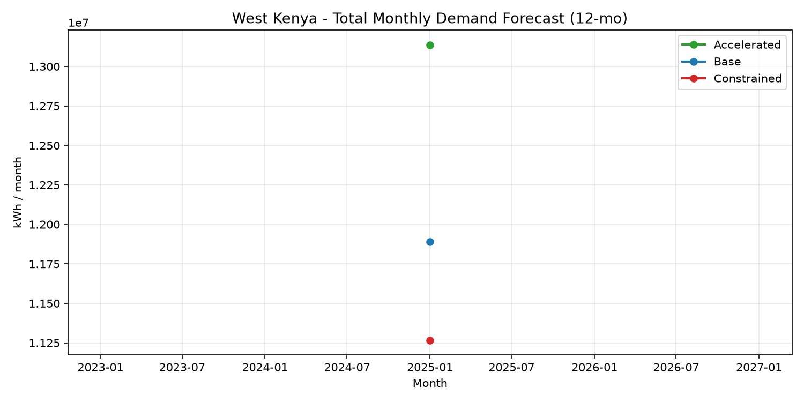

# West Kenya Energy Growth Forecast

Forecasting electricity demand and new connections for Kenya Power (KPLC)
operations in Western Kenya (Kisumu, Kakamega, Vihiga, Siaya, Busia, Bungoma).

## Results

| Model | Target | Holdout MAPE |
|---|---|---|
| XGBoost | New connections / month | 14.96% |
| XGBoost | kWh per connection / month | 3.70% |



## Approach

Dual-model architecture:
- **Connection growth** — new meters per month
- **Per-connection demand** — kWh per connection per month

Both models use XGBoost with lag features (1, 2, 3, 6, 12 months)
and rolling means (3, 6, 12 months), split on a 6-month time holdout.
Bottom-up scenario generation: **Base / Accelerated / Constrained**.

## Quickstart

```bash
python -m venv venv
venv\Scripts\activate          # Windows
pip install -r requirements.txt

python -m src.generate_data    # data/raw/synthetic.csv
python -m src.train            # models/*.pkl
python -m src.scenarios        # data/processed/forecast_scenarios.csv
python -m src.plot             # docs/forecast_scenarios.png"# west-kenya-energy-forecast2" 
